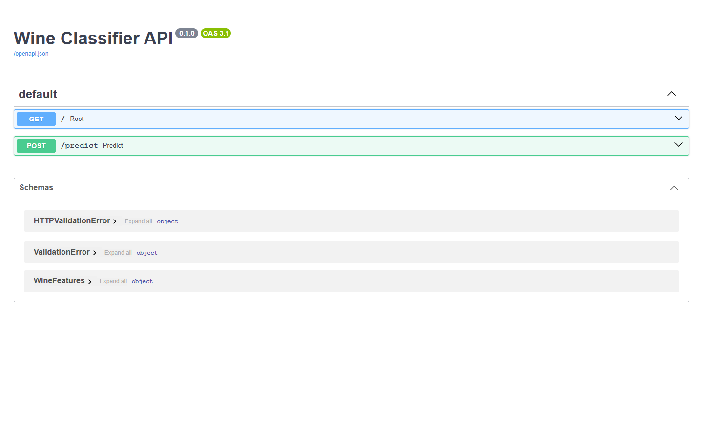
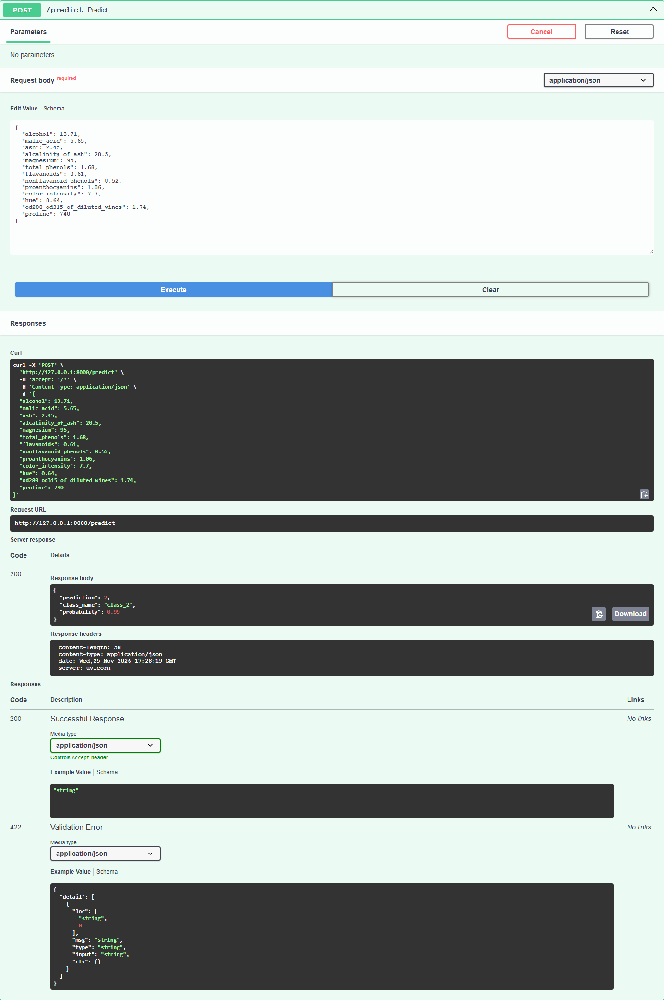
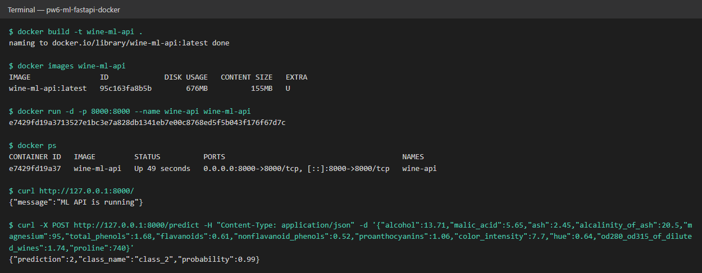

# Practical Task 6 — Deploy ML Model with FastAPI and Docker

**Student:** Abdimutalipov Zhaxylyk, 23B031056

Here we train a simple classification model and deploy it as an API with FastAPI and Docker.

## Dataset and model

- **Dataset:** Wine dataset (UCI, built into scikit-learn) — 178 wines, 13 chemical features, 3 classes (3 grape cultivars: `class_0`, `class_1`, `class_2`)
- **Model:** RandomForestClassifier (100 trees, random_state = 42)
- **Split:** 80% train / 20% test, stratified
- **Result on test set:** accuracy = 1.0, F1 macro = 1.0 (wine dataset is small and classes are well separated, thats why score is so high)

## Project structure

```
pw6-ml-fastapi-docker/
├── main.py           # fastapi app
├── train.py          # trains and saves the model
├── model.joblib      # saved model (artifact)
├── requirements.txt  # python dependencies
├── Dockerfile        # container instructions
└── README.md
```

## 1. Train the model

```bash
pip install -r requirements.txt
python train.py
```

It creates `model.joblib`.

## 2. Run API locally (uvicorn)

```bash
uvicorn main:app --reload
```

- `GET  http://127.0.0.1:8000/` → `{"message": "ML API is running"}`
- `POST http://127.0.0.1:8000/predict` → prediction
- Swagger docs: http://127.0.0.1:8000/docs

Example request:

```bash
curl -X POST http://127.0.0.1:8000/predict \
  -H "Content-Type: application/json" \
  -d '{"alcohol":13.71,"malic_acid":5.65,"ash":2.45,"alcalinity_of_ash":20.5,"magnesium":95,"total_phenols":1.68,"flavanoids":0.61,"nonflavanoid_phenols":0.52,"proanthocyanins":1.06,"color_intensity":7.7,"hue":0.64,"od280_od315_of_diluted_wines":1.74,"proline":740}'
```

Response:

```json
{"prediction": 2, "class_name": "class_2", "probability": 0.99}
```

## 3. Docker

Build image:

```bash
docker build -t wine-ml-api .
```

Run container:

```bash
docker run -d -p 8000:8000 --name wine-api wine-ml-api
```

Then test again the same endpoints: http://127.0.0.1:8000/ , http://127.0.0.1:8000/docs and `/predict`.

Stop:

```bash
docker stop wine-api && docker rm wine-api
```

## Conclusion

- `model.joblib` is the artifact which API loads at startup
- FastAPI gives us Swagger UI automatically, so we can test `/predict` in the browser
- Docker image contains code + dependencies + model, so it works same on any machine

## Screenshots

**GET /** — API is running


**Swagger UI** (`/docs`)



**POST /predict** from Swagger — class 2 wine is predicted correctly



**Docker** — image is built, container is running and API answers from the container


